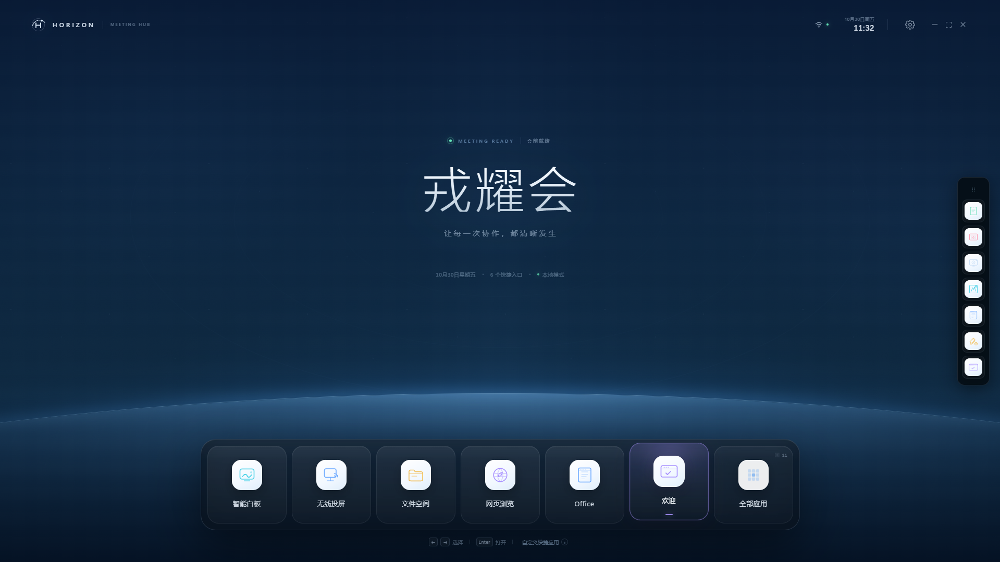
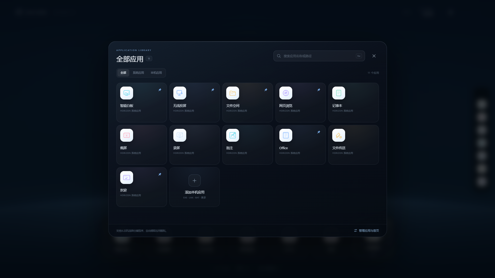
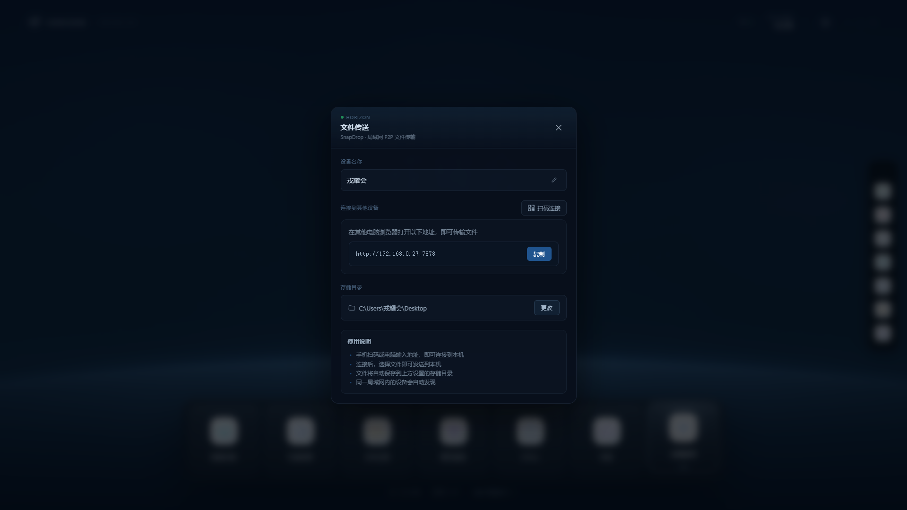

# HORIZON 开源会议白板启动器

面向windows的开源会议大屏的 Windows 启动器：一个可自定义的入口面板，加上投屏接收/发送、文件传送、白板批注等会议现场能力。

## 界面

| 首页（会议迎宾） | 全部应用 |
| --- | --- |
|  |  |

| 个性化与设置 | 文件传送 |
| --- | --- |
|  |  |

## 功能

**启动器**
- 应用网格：导入本机 exe/lnk（自动取图标），支持分组、置顶、侧边栏快捷工具
- 无边框全屏迎宾：全屏覆盖任务栏，退出后精确还原窗口位置与大小
- 欢迎页：背景图片与背景音乐，编辑态与展示态分离
- 智能白板（Drawnix）、批注（调用本机批注应用）、办公应用（用户自选默认程序）
- 截屏 / 录屏：按系统版本分派——Windows 11 走截图工具，Windows 10 走 Xbox Game Bar / 截图与草图
- 开机启动（HKCU Run）、应用内一键放行 Windows 防火墙

**投屏**
- AirPlay投屏（接收）：RAOP 音频 + 视频镜像
- 浏览器扩展投屏：Chrome/Edge MV3 扩展抓取标签页或屏幕，WebCodecs 编 H.264，局域网直连接收端(投屏码：大屏显示 6 位码，扩展输入即投，无需配对)
- Miracast投屏：走系统「投影」入口

**文件传送**
- 内置 SnapDrop 服务（自托管，默认端口 7878）：局域网任意设备打开地址即可互传，带二维码

## 技术栈

| 层 | 技术 |
| --- | --- |
| 桌面外壳 | Tauri 2（Rust）、WebView2 |
| 前端 | React 19、TypeScript、Vite |
| 投屏引擎 | `crates/horizon-cast`（Media Foundation 采集/编码、AirPlay / CASTV2 / DLNA 协议栈） |
| 浏览器扩展 | Chrome Manifest V3、WebCodecs、Offscreen Document |

## 环境要求

- Windows 10 1809+ / Windows 11（x64）
- Node.js 20+
- Rust stable（MSVC toolchain）+ Visual Studio Build Tools（C++ 桌面开发）
- WebView2 Runtime（Win11 自带）

## 开发与构建
```bash
npm install            # 安装前端依赖
npm run desktop        # 开发模式（Vite + Tauri，热更新）
npm run desktop:build  # 发布构建：生成 exe 与 NSIS 安装包
```

单独跑引擎测试：
```bash
cargo test -p horizon-cast
cargo test -p horizon-launcher
```

## 浏览器扩展
`extension/` 即完整的 MV3 扩展。Chrome/Edge 打开 `chrome://extensions` → 开发者模式 → 加载已解压的扩展程序 → 选择该目录。扩展会扫描局域网内的接收端（`/info` 探针），也可手动输入大屏投屏码。

## 目录结构
```
src/                  React 前端（启动器、面板、投屏 UI、设置）
src-tauri/            Tauri 外壳：窗口、命令、托盘、SnapDrop 服务、防火墙、开机启动
crates/horizon-cast/  投屏引擎：采集、编码、AirPlay / Cast / DLNA / 浏览器通道
extension/            浏览器投屏扩展
public/               静态资源
tools/                一次性脚本（如 FairPlay 常量表生成）
docs/                 架构说明与验证记录
```

版本与打包配置见 `src-tauri/tauri.conf.json`。

## 数据位置

| 内容 | 路径 |
| --- | --- |
| 启动器配置 | `%APPDATA%/com.horizon.meeting/launcher-state.json` |
| 文件传送配置 | `%APPDATA%/horizon-launcher/snapdrop-config.json` |
| 接收的文件 | 面板中设置（默认系统下载目录） |

## 端口

| 用途 | 端口 |
| --- | --- |
| 文件传送（SnapDrop） | 7878（可改） |
| 浏览器扩展投屏 | 9407 |
| CASTV2 | 8009 |
| mDNS / SSDP 发现 | 5353 / 1900 |

局域网首次使用需在 Windows 防火墙放行入站规则，应用内提供一键放行（一次 UAC）。

## 说明
- `crates/horizon-cast/assets/` 下的证书与私钥仅用于本机开发调试（自签名，绑定 localhost/局域网地址），不要用于生产环境。
- `resources/fairplay/` 中的常量表来自公开的 AirPlay 互操作实现，仅供协议研究与个人使用；FairPlay 相关权利归 Apple。
- 本项目为会议现场自用工具，未做多租户与公网暴露场景的安全加固，请勿将文件传送端口直接暴露到公网。

## 许可
MIT，见 [LICENSE](LICENSE)。
